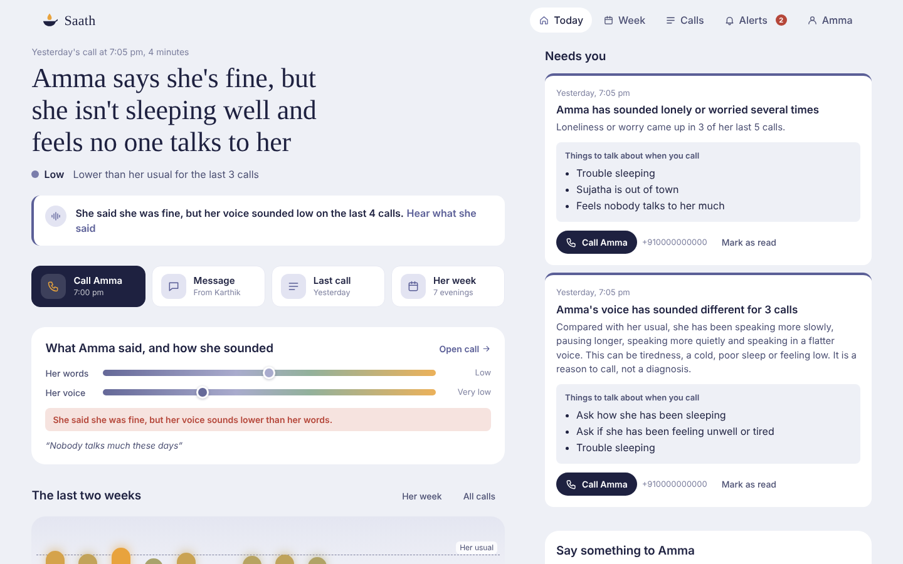
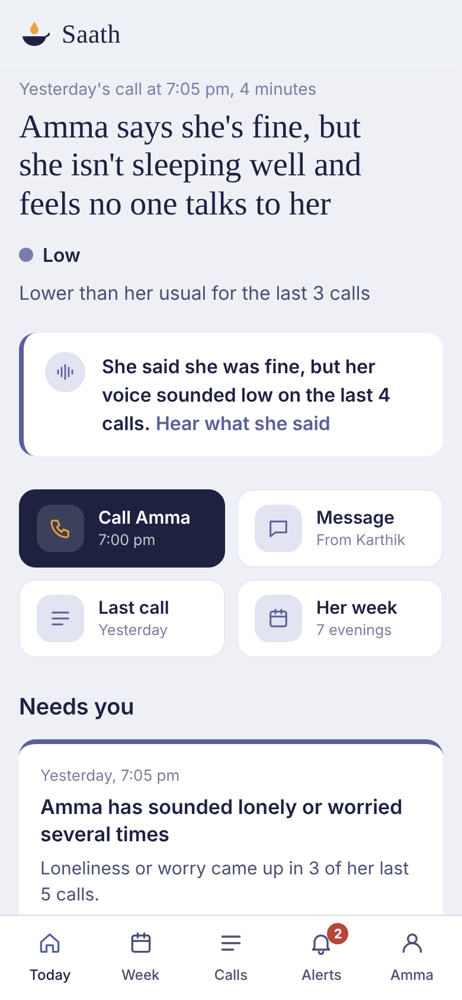
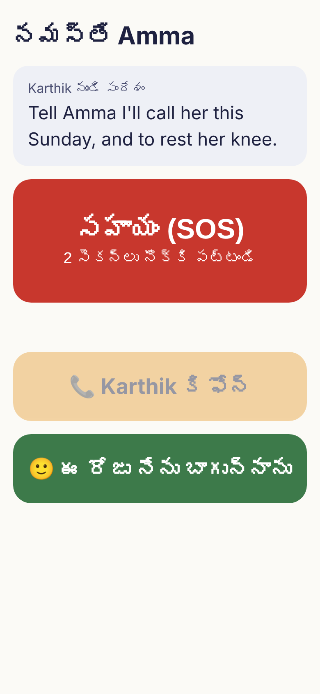
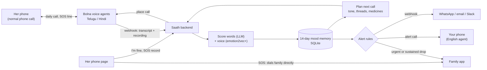

# Saath

<p align="center"></p>

**A daily voice check-in call in Telugu and Hindi for parents who live alone.** Saath calls every evening on a normal phone, scores how she feels from both her **words** and her **voice**, remembers her usual mood, adapts the next call, and alerts the family when she seems lower than usual or needs help.

Built for the Bolna Buildathon (Oct 2026).

> **Live app:** https://saath-v6na.onrender.com/ · example call page: https://saath-v6na.onrender.com/#/calls/26
> Hosted on Render's free plan, so it may sleep after 15 minutes idle and the first load can be slow. Demo data is labelled as sample history.

## No internet needed on her phone

| Feature | Her phone needs |
| --- | --- |
| Daily Saath call | Nothing. It's a normal phone call, no app and no data. |
| "Call Karthik" button | Nothing. It dials you directly. |
| SOS button | Nothing for the call. It dials the family directly even with no internet. The alert record is sent once she is online. |
| "I'm fine today" | Internet. If there's none, the page says "No internet." |
| Talk to Saath (SOS line) | Nothing. It's a phone call. Shown only when a Saath number is set. |
| Opening her page | Internet the first time. After that the page opens offline. |

## Screens

| Family app (desktop) | Family app (mobile) |
| --- | --- |
|  |  |

**Her phone page (mobile):** the big SOS button, a call-you button, and "I'm fine today". The page is in her language (Telugu or Hindi). The screenshot shows sample data.

<p align="center"></p>

## Features

**The daily call**
- Calls her every evening in Telugu or Hindi, built on Bolna voice agents.
- Greets her by name, knows her medicines, and picks up open threads from the last call.
- Carries messages from you into the call and brings back her reply.
- Reminder calls for medicines, and records whether she answered.

**Scoring**
- **Words:** one LLM call over the transcript returns emotions, valence, evidence quotes, meals, medicines, worries and a summary.
- **Voice:** emotion2vec+ scores tone on her speech. It isn't trained specifically on Telugu or Hindi, so it's shown beside the words.
- **Mismatch:** a flag when she says she's fine but her voice sounds low.
- **Voice wellness:** speaking pace, pauses, loudness and pitch, compared only with her own usual. Worded as a reason to call, never a diagnosis.

**Memory**
- A 14-day mood memory, so Saath knows her usual.
- Each call adapts to her: tone, open threads and the medicines to check.

**Alerts**
- **Urgent:** emergency words, or an SOS.
- **Sustained drop:** her last 3 calls averaged 0.3 or more below her 14-day median.
- **Recurring worry:** loneliness or worry in 3 of her last 5 calls.
- **Voice away from usual:** two or more voice signals away from her usual over her last 3 calls.
- **Missed check-in:** no answer after a retry.
- One bad day never sends an alert on its own. All thresholds are starting values, not measured results.
- Alerts reach you by an alert call from an English agent, and/or a webhook (WhatsApp, email or Slack).

**Family app**
- **Today:** the one-line answer, the last two weeks, what needs you, a message for her, meals and medicines, tonight's call plan.
- **Ask her now:** type a question, Saath rings her and brings back the answer.
- **Week:** the last 7 evenings against the 7 before, with check-ins, medicines, meals, feelings, topics, and best and hardest evening.
- **Calls and call detail:** words vs voice, how she spoke against her usual, her own words, and the conversation in Telugu/Hindi and English.
- **Alerts** and **Profile** (reminder times, her Saath number, your phone, which alerts reach you).
- **Call from your computer:** talk to Saath from the browser, no phone needed.

**Emergencies**
- Her words trigger an urgent alert the moment she mentions a fall or chest pain.
- A live transfer (Bolna's Transfer Call tool) connects her to you mid-call.
- The SOS line: she can call Saath. Saath greets her, knows her context, and alerts you. If the line drops, Saath rings her back.

## How it works



## Run the backend


```bash
cd backend
pip install -r requirements.txt          # add requirements-voice.txt for emotion2vec+ (torch)
cp ../.env.example ../.env               # fill in keys when you have them
python -m app.seed --reset               # labelled demo history (13 evenings)
uvicorn app.main:app --reload --port 8000
```

**LLM for testing:** any OpenAI-compatible endpoint works. `.env.example` has ready blocks for OpenAI's open-weight gpt-oss on Groq (`openai/gpt-oss-120b`), the same model locally with Ollama (`gpt-oss:20b`, no key), OpenAI's API, and Sarvam-105B for the final build. Switching is config only.

With no keys it runs in mock mode: calls fail with a clear error, text scoring uses a keyword stand-in (`source: "mock"`), and voice scoring is skipped.

## Run the family app

```bash
cd web
npm install
npm run dev            # http://localhost:5173, proxies /api to the backend on :8000
```

If the backend isn't reachable, the app falls back to a bundled snapshot of the seeded demo (`src/demo/snapshot.json`) and says so at the top. Regenerate it after changing the seed with `python -m app.snapshot` (from `backend/`). `npm run build:single` produces one self-contained HTML file for sharing the demo.

Screens: Today (the one-line answer, the last two weeks, what needs you, a message for her, meals and medicines, tonight's call plan), Week, Calls, Call detail (words vs voice, how she spoke against her usual, her own words, your message and her reply, the conversation in Telugu/Hindi and English), Alerts (with how each reached you), Profile (reminder times per medicine, her Saath number, your phone and which alerts Saath calls you about), Setup, and the browser Test call.

## Test call in the browser (no Bolna needed)

With an OpenAI key in `.env` (`LLM_BASE_URL=https://api.openai.com/v1` plus `LLM_API_KEY`, or a separate `OPENAI_API_KEY`), open the app and choose **Try it in your browser** on Today. You answer as the parent through your mic; OpenAI does what Bolna does on a real call:

| Job | Model (override in `.env`) |
| --- | --- |
| Hear the parent | `OPENAI_STT_MODEL=gpt-4o-mini-transcribe` |
| Decide what to say | `LLM_MODEL`, using the same prompt as `prompts/agent_te.md` / `agent_hi.md` |
| Speak | `OPENAI_TTS_MODEL=gpt-4o-mini-tts-2025-12-15`, `OPENAI_TTS_VOICE=coral` |

Pick the kind of call first: the evening check-in, a medicine reminder, or **She calls Saath** (the SOS line from her side). Ending the call scores it through the same pipeline as a phone call and adds it to the parent's history. It carries your pending message like a real call, and an emergency phrase raises the urgent alert mid-call, but a test call never phones anyone. Only the parent's turns are recorded, so the voice signal gets clean parent-only audio (merging the turns needs `ffmpeg` on your PATH; without it the call is scored on words only).

## Connect Bolna (day 1)

1. Create two agents in the Bolna dashboard (Telugu, Hindi). Paste the welcome message and system prompt from `backend/prompts/agent_te.md` / `agent_hi.md`. Set Sarvam `saaras:v3` as transcriber and `bulbul:v3` as voice.
2. Put the agent IDs and your API key in `.env` (`BOLNA_AGENT_ID_TE`, `BOLNA_AGENT_ID_HI`, `BOLNA_API_KEY`).
3. Expose the backend: `ngrok http 8000`, then set the agent webhook to `https://<id>.ngrok.app/webhooks/bolna`.
   No tunnel? The backend also polls Bolna every 30 s for open calls, so calls still get processed.
4. `POST /api/parents/1/call-now` (or the app's Call now button) and your phone rings.

Per-call context reaches the agent through `user_data` on `POST /call`, which fills `{{variables}}` in the prompt and welcome message.

**Check on the first real call:** whether Bolna's recording is two-channel, and which channel is the parent. Set `PARENT_CHANNEL` accordingly. A one-channel recording is scored as `mixed` and down-weighted.

**Optional, for the full demo:**
- SOS line: link a Bolna number to her agent for inbound calls, point caller identification at `/webhooks/bolna/caller`, set `SOS_NUMBER` (`bolna_tools.md` section 3).
- Emergency tool + live transfer: follow `backend/prompts/bolna_tools.md`, then set `TOOL_TOKEN` and `TRANSFER_ON_EMERGENCY=true`. Use a second phone as "your" number: transferring to the phone you're testing on can't work.
- Alert calls to you: create the English agent from `backend/prompts/agent_alert_en.md`, set `BOLNA_AGENT_ID_ALERT`, and add your phone in Profile.

## Voice model

```bash
pip install -r requirements-voice.txt      # torch + FunASR; large download
python -m app.check_voice                  # scores the model's sample clip and your latest test call
```

It downloads emotion2vec+ large from Hugging Face on first run (`VOICE_HUB=ms` for ModelScope). Until it's installed, calls are scored on words only and the "said fine, sounded low" flag can't fire.

## Evaluation and tests

```bash
python -m app.evaluate                     # 32 scripted Telugu/Hindi calls with known answers
python -m pytest -q tests                  # rules, flows, SOS line, reminders, voice signals, migration
```

`app.evaluate` writes `results/eval-<model>-<time>.json` and prints accuracy for emergencies (split by LLM vs keyword safety net, and false alarms on calm calls), "said fine", mood direction, medicines and meals, per language. Every number comes from the run. The cases are scripted, so they measure how the scoring reads clear examples, not how it does on real parents.

## Hosting

One server runs everything: after `npm run build` in `web/`, the backend serves the app at `/` beside the API. `Dockerfile` builds both (`--build-arg VOICE=1` adds the voice model) and keeps the database on a `/data` volume. On Railway or Render, attach a volume at `/data`, set the `.env` values as environment variables, and point Bolna's webhook and tool URLs at the public address. Existing databases upgrade themselves on start.

## API

| Method | Path | Purpose |
| --- | --- | --- |
| GET | `/api/health` | Which keys and models are configured |
| GET/POST | `/api/parents` | List / set up a parent (optionally places the intro call) |
| PATCH | `/api/parents/{id}` | Edit profile, consent, medicines |
| GET | `/api/parents/{id}/overview` | Today card, latest call, stats, unseen alerts, next-call plan |
| GET | `/api/parents/{id}/trend?days=14` | Mood points with mismatch and alert markers |
| GET | `/api/parents/{id}/calls` | Call history |
| GET | `/api/calls/{id}` | Call detail: transcript, English rendering, words vs voice |
| GET | `/api/calls/{id}/audio` | Recording |
| GET | `/api/parents/{id}/alerts`, POST `/api/alerts/{id}/seen` | Alerts |
| GET/POST | `/api/parents/{id}/notes`, DELETE `/api/notes/{id}` | Messages from the child |
| GET | `/api/parents/{id}/week` | Weekly digest |
| POST | `/api/parents/{id}/call-now` | Place a call now |
| POST | `/api/test-call/start`, `/{id}/turn`, `/{id}/end` | Browser test call |
| POST | `/webhooks/bolna` | Bolna execution updates |
| GET/POST | `/webhooks/bolna/tools/urgent` | Mid-call emergency tool |
| GET/POST | `/webhooks/bolna/caller` | Caller identification for the SOS line (inbound calls) |
| POST | `/api/dev/simulate-call` | Run the pipeline on a pasted transcript, no phone call |

## Honest notes for judges

- Seeded history is marked `is_seeded` and labelled in the UI. Alerts on seeded data come from the same rules engine as live calls.
- The voice model has not been validated on Telugu or Hindi speech; it is shown beside the words signal.
- Voice wellness signals are checked on synthetic audio in the tests, not on real elderly speakers. The seeded "slower, quieter" trend is sample data. Real calls are measured, and only ever compared with the same person's usual.
- Saath gives no medical advice. On emergency words the family is alerted immediately and the parent is told to call a neighbour or 108.
- The intro call tells the parent Saath is an AI assistant and that it shares a short daily note with her child, and daily calls start only if she agrees.
- If a scheduled call can't be placed (Bolna down, wallet empty), Saath retries once, then raises a missed check-in alert with the reason. After a restart it catches up on a call it missed in the last 2 hours and re-schedules a pending retry.
